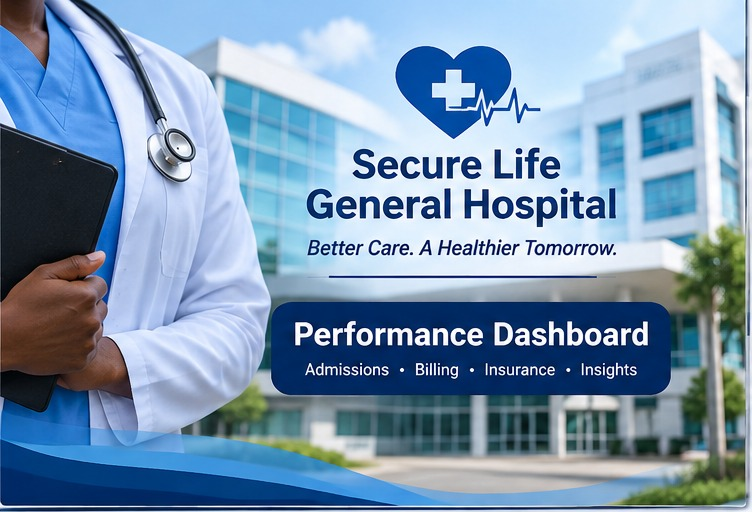
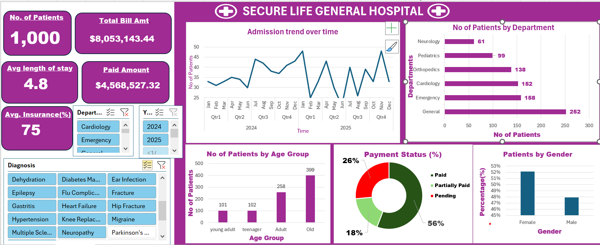

# SECURE LIFE HOSPITAL PERFORMANCE DASHBOARD
## Introduction

Healthcare facilities generate large amounts of data from daily patient admissions, medical services, billing, and insurance transactions. However, when this information is not properly organized and analysed, it can be difficult for hospital management to monitor performance, identify operational challenges, and make informed decisions.
This project focuses on analysing hospital patient records and developing a performance dashboard for Secure Life General Hospital. The dashboard provides an overview of patient visits, departmental performance, billing, payment status, insurance coverage, and average length of stay.
The aim is to transform raw hospital data into meaningful insights that can help management understand hospital operations, monitor financial performance, and identify areas that require improvement.
## About the Dataset
The dataset contains 1,000 patient visit records covering the period from January 2024 to December 2025. Each row represents a patient visit and contains information relating to patient demographics, hospital admissions, medical departments, diagnoses, billing, and payment details.
The dataset includes the following information:

**Patient information**: Patient ID, patient name, age, and gender.

**Admission details**: Admission date, discharge date, department, and diagnosis.

**Financial information**: Total bill amount, amount paid, and patient responsibility.

**Insurance information**: Insurance coverage percentage and estimated insurance coverage.

**Operational information**: Payment status and length of hospital stay.

The dataset was prepared and analysed to identify patterns in patient visits, compare departmental performance, examine payment records, and understand insurance coverage across the hospital.
## Problem Statement
Hospital management needs reliable information to understand how different departments are performing, how patient visits are distributed, and how effectively billing and payment processes are being managed.
Without a consolidated view of these records, it may be difficult to identify departments with high patient traffic, monitor outstanding bills, evaluate insurance coverage, and track changes in hospital activity over time.
This project addresses the need for a centralized and visual approach to hospital performance monitoring. It uses data analysis and dashboard visualizations to answer important questions about patient visits, departmental activity, financial performance, payment status, and insurance coverage.
## Visualization

The dashboard above summarizes the key indicators and comparisons calculated from the dataset.
## Insights
The analysis revealed several findings from the 1,000 patient visit records:
1. The hospital recorded a total of 1,000 patient visits during the period covered by the dataset.
  
2.The General department recorded the highest number of patient visits, indicating that it handled the largest share of patient traffic.

3. Orthopedics recorded the highest total bill amount among the departments, making it the department with the largest billing contribution.

4.A total of 56.4% of patient visits were marked as fully paid. The remaining visits were classified as either pending or partially paid.

5.The total bill amount was 8,053,143.44, while the recorded amount paid was 4,568,527.32. This resulted in an outstanding balance of 3,484,616.12.

6.The average insurance coverage across patient visits was 74.86%, showing that insurance accounted for a substantial proportion of the recorded coverage.

7.The average patient length of stay was approximately 4.81 days. This provides a general indication of how long patients remained in the hospital.

8.The age-category analysis showed that adults accounted for the largest number of patient visits.
 ## Recommendations
Based on the findings from the analysis, the following recommendations are proposed:

1.The hospital should strengthen its payment monitoring process by regularly reviewing pending and partially paid bills and following up on outstanding balances.

2.Management should regularly evaluate patient visits and billing across departments to understand workload distribution and identify areas that may require additional resources.

3.The hospital should monitor insurance coverage and claims more closely to identify gaps, reduce processing delays, and improve coordination with insurance providers.

4.Departments should review patient admission and discharge patterns to identify opportunities to improve patient flow and resource utilization.

5.Monthly patient visits and billing activities should be monitored to identify changes in hospital activity and support better planning.
## Conclusion
This project demonstrates how data analysis and visualization can be used to improve the understanding of hospital operations and financial performance. By analysing 1,000 patient visit records, the project identified important patterns in departmental activity, patient visits, billing, payment status, insurance coverage, and length of stay.
The dashboard brings these findings together in a clear and accessible format, allowing hospital management to monitor key performance indicators and identify areas that require attention.
In conclusion, the project highlights the value of data-driven decision-making in healthcare management and demonstrates how raw hospital records can be transformed into meaningful information that supports better operational planning and financial monitoring.
